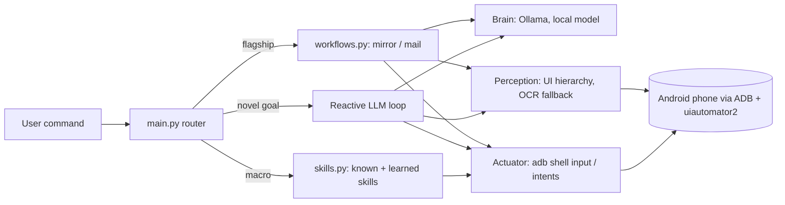

# Re-Node

**An Edge-AI Driven Autonomous Mobile Agent for Offline Digital Accessibility and E-Waste Upcycling**

Re-Node lets you control an Android phone in plain language, with the AI running **locally on your own laptop** and the phone kept **offline except for the single moment it must send something**. No cloud model, no screenshots uploaded anywhere, no app or root access required on the phone.

> B.Tech (Computer Science and Engineering, AI specialization) final-year major project.
> Team: `<names>` · Guide: `<guide name>` · `<college name>`, `<year>`

<!-- Add a demo GIF or screenshot here:  -->

---

## Why Re-Node

| | Rule-based tools (Tasker, MacroDroid) | Cloud AI phone agents | **Re-Node** |
|---|---|---|---|
| Understands plain language | No, rules are written by hand | Yes | **Yes** |
| AI runs offline | n/a | No, screen data goes to a server | **Yes, local model via Ollama** |
| Controls when the phone goes online | No | No | **Yes, Wi-Fi on only for the send step** |
| Needs root or an app on the phone | Often | Often | **No, USB debugging only** |
| Learns new tasks | No | Varies | **Yes, successful runs are cached as skills** |

*(Comparison is about typical tools in each category; check specific products before quoting them.)*

## Features

- **Natural-language control** of the phone through a local small language model (`gemma:2b` by default; any Ollama model works).
- **`mirror`**: opens the camera and makes sure it is on the front (selfie) lens, using the camera service and UI hierarchy to verify the lens before flipping.
- **`mail`**: a cross-app workflow with 11 steps. It reads the first note from the Notes app, composes it in Gmail, switches Wi-Fi on through the Control Panel only for the send, then switches it off again and returns Home.
- **Quick-settings macros**: Wi-Fi, Bluetooth, flashlight, airplane mode, Home, Back, Quick Settings.
- **Three-tier execution**: hand-written skills, then a learned-skill cache, then a reactive perceive, plan, act LLM loop for goals it has not seen.
- **Air-gap safety**: if any step fails after Wi-Fi is switched on, a `finally` block forces it off.
- **Multi-brand selector chains** (`resource-id`, then `content-desc`, then `text`) so buttons are found across ColorOS, MIUI/HyperOS, One UI and stock Android.
- **`inspect_ui.py`**: a diagnostic that lists every clickable element on the current screen, so a new phone can be mapped in about 30 seconds.
- **Simulation tests**: a fake phone lets the workflows be tested without hardware.
- *(If included in your build)* **Control Center UI** (`gui.py`) with command buttons, live logs, brain reasoning, step progress and a Wi-Fi exposure timer, and **timer and alarm control** by typed command.

## How it works



**Hybrid design:** the model classifies the command and narrates the plan, while deterministic UIAutomator2 and ADB steps do the actual tapping. Small local models are not reliable at precise actions, so the AI is used where it is strong and code is used where reliability matters.

| Layer | File | Role |
|---|---|---|
| Entry and routing | `main.py` | Connects to the phone and routes each goal |
| Perception | `perception/perception.py` | UI-tree parsing, selector chains, OCR fallback (lazy-loaded) |
| Brain | `brain/brain.py` | Local Ollama calls: next-action planning, intent and plan narration |
| Actuator | `actuator/actuator.py` | ADB commands, taps, intents, Wi-Fi and camera state helpers |
| Skills | `skills.py` | Hand-written macros and the learned-skill cache |
| Workflows | `workflows.py` | `mirror` and `mail` pipelines |
| Diagnostics | `inspect_ui.py`, `diagnose_qs.py`, `find_wifi_tile.py` | Inspect what the phone exposes |

## Security and privacy model

- The AI model and all screen parsing run on the host machine. No cloud API is called.
- The phone is controlled only through the authorised USB debugging link.
- The network is treated as a privilege: Wi-Fi is switched on only inside the `mail` workflow, right before Send, and switched off right after.
- Before the phone goes online, nothing outside the host/phone pair is contacted.

Internet is needed only for one-time setup (installing packages and pulling the model) and for the email send itself.

## Requirements

- **Host:** Windows, Linux or macOS, Python 3.10+ (Python 3.14 works, see Troubleshooting), [Ollama](https://ollama.com), ADB (Android platform-tools), optionally scrcpy to mirror the screen.
- **Phone:** Android with **USB debugging** enabled. Developed and tested on a Realme RMX3085 (Android 13, ColorOS).
- Gmail signed in and a Notes app with at least one note (for the `mail` workflow).

## Quick start

```powershell
# 1. Get the code and create an environment
git clone <this-repo-url>
cd renode
python -m venv .venv
.venv\Scripts\activate            # Linux/macOS: source .venv/bin/activate

# 2. Install dependencies
pip install uiautomator2 requests python-dotenv loguru pytest
# Optional OCR fallback (large, pulls in PyTorch):  pip install easyocr

# 3. Start the local model
ollama pull gemma:2b
ollama serve

# 4. Connect the phone and check it is authorised
adb devices                        # should show "device", not "unauthorized" or "offline"

# 5. Configure
copy .env.example .env             # Linux/macOS: cp .env.example .env
# edit .env and set MAIL_DEFAULT_RECIPIENT=you@example.com

# 6. Run
python main.py                     # interactive prompt
python main.py mirror              # one-shot
python main.py mail
```

If you have the UI: `python gui.py` (or `python gui.py --demo` to try it without a phone).

## Commands

| Command | What happens |
|---|---|
| `mirror` | Opens the camera on the front lens |
| `mail` | Copies the first note, emails it through Gmail, Wi-Fi on only for the send |
| `turn on wifi` / `turn off wifi` / `wifi` | Toggles Wi-Fi from the Control Panel |
| `bluetooth`, `flashlight`, `airplane` | Toggles the matching quick-settings tile |
| `quick settings`, `go home screen`, `go back` | Navigation helpers |
| `mirror legacy` | The original camera macro |
| anything else | Handled by the reactive LLM loop and cached if it succeeds |

Note: the existing Wi-Fi macro **toggles** the tile, so "on" and "off" behave the same.

## Configuration (`.env`)

| Variable | Default | Meaning |
|---|---|---|
| `MAIL_DEFAULT_RECIPIENT` | placeholder | Required for `mail` unless the note contains an address |
| `OLLAMA_MODEL` | `gemma:2b` | Any model pulled into Ollama |
| `OLLAMA_ENDPOINT` | `http://localhost:11434` | Local Ollama address |
| `ADB_SERIAL` | empty | Set when more than one device is connected |
| `NOTES_PACKAGE`, `CAMERA_PACKAGE` | auto-detect | Override if detection picks the wrong app |
| `FRONT_CAMERA_IDS` | `1` | Camera ID(s) of the front lens |
| `MIRROR_UNKNOWN_FACING_ACTION` | `tap` | `tap` or `skip` when the lens cannot be verified |
| `WIFI_CONNECT_WAIT_S`, `SEND_WAIT_S` | `5` | Waits around the send step |
| `BRAIN_WARMUP` | `true` | Load the model once at startup |

See `.env.example` for the full list.

## Testing

```powershell
python -m pytest tests -q
```

The tests run both workflows against a simulated phone (`tests/fake_phone.py`), including failure cases such as the Wi-Fi fail-safe and refusing to type outside the Gmail composer. They check the logic, not any specific phone's screens, so always rehearse on the real device too.

## Adapting to a new phone

```powershell
python inspect_ui.py --packages                       # find Notes / Camera / Gmail package names
python inspect_ui.py                                  # clickable elements on the current screen
python inspect_ui.py --package com.google.android.gm  # one app only
python inspect_ui.py --qs                             # Quick Settings
```

When a `mail` step fails, the screen is saved to `logs/last_failure_ui.txt`. Logs are written to `logs/re_node.log`.

## Troubleshooting

- **`adb devices` shows nothing:** use a data cable, set USB mode to File transfer, enable USB debugging, then `adb kill-server && adb start-server`.
- **`unauthorized` / `offline`:** accept the "Allow USB debugging?" prompt, or revoke USB debugging authorisations in Developer options and reconnect.
- **`pip install` fails building Pillow or pydantic-core (Python 3.14):** the pinned versions in `requirements.txt` have no 3.14 wheels. Install the unpinned packages listed in Quick start instead.
- **`No module named easyocr`:** it is only needed for the OCR fallback and is imported lazily.
- **Slow first `[BRAIN]` line:** the model is loading; keep `BRAIN_WARMUP=true` and warm up before a demo.
- **`mail` does nothing useful:** set `MAIL_DEFAULT_RECIPIENT`, check Gmail is signed in, and use the dump in `logs/last_failure_ui.txt`.

## Limitations

- Needs a laptop or PC connected by cable for now.
- A 2B local model is much weaker than a cloud model; precise actions are handled by deterministic steps, and the model's role is intent, planning and the fallback loop.
- Reliability is highest on the engineered workflows (`mirror`, `mail`, quick-settings macros). Novel goals through the reactive loop work best on simple tasks.
- Some screens cannot be read (custom-drawn apps, games, secure screens such as banking apps), and CAPTCHAs and biometric prompts need a human.
- OEM UI changes can break selectors; `inspect_ui.py` is the tool for fixing them.

## Roadmap

- Move the whole stack onto the phone (Termux with a local model, or a native accessibility-service app).
- Offline voice control with a local speech model.
- Larger quantised models and self-healing selectors.
- Privacy guard that scans content for sensitive data before the phone goes online, plus an air-gap audit log.

## Acknowledgements

Built with [uiautomator2](https://github.com/openatx/uiautomator2), [Ollama](https://ollama.com), ADB and scrcpy.

## License

`<choose a license, for example MIT, and add a LICENSE file>`
